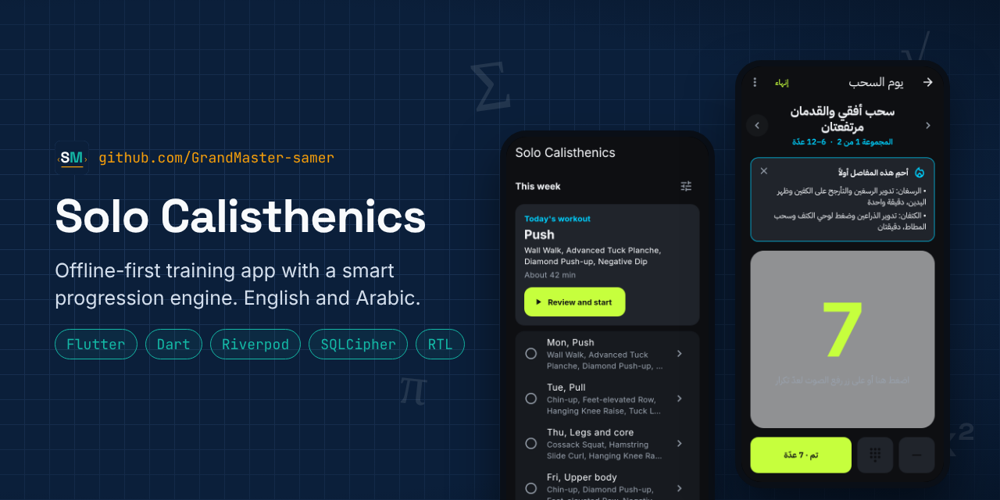
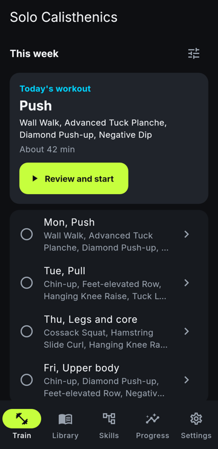
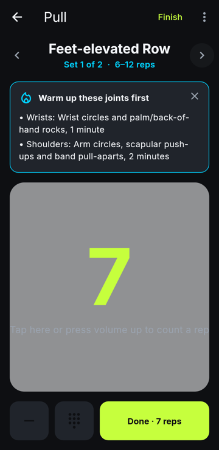
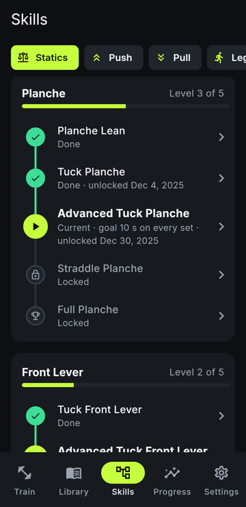
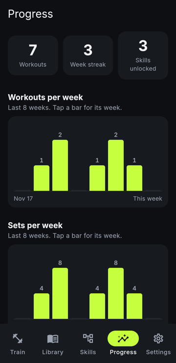
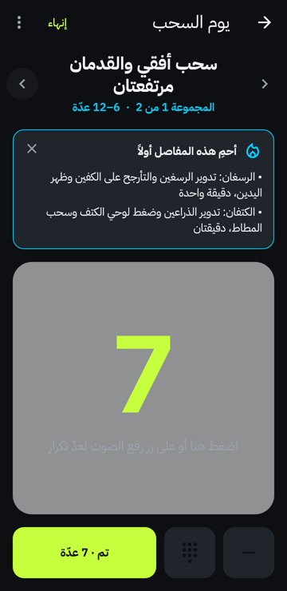

<p align="center"></p>

# Solo Calisthenics

<p>


</p>

An offline-first, privacy-first calisthenics training app for Android 8.0+ and iOS 15+.
It builds a weekly plan from your level, goals and injuries, then **adapts it automatically** as you log sets.
It has full **English and Arabic (RTL)** support, no account, no server and no analytics.

## Highlights

- **Progression engine (pure Dart, unit-tested).** It advances, holds or regresses each exercise from your logged reps and holds, and schedules deload weeks.
- **Injury-aware.** Exercises that stress an injured joint are filtered, swapped for a safer regression, or capped.
- **Encrypted by default.** A Drift database on SQLCipher, with the key in the platform keystore, a PIN/biometric app lock and encrypted backups.
- **Crash-safe sessions.** Every set is saved immediately. The rest timer survives the screen turning off or the app being killed.
- **80 exercises in 15 progression chains**, plus a skill tree, a progress dashboard and a private photo vault.
- **Optional cloud (Supabase):** Google sign-in, passphrase-encrypted backup and coach review, all behind a `CloudBackend` interface.

## Screenshots

| Weekly plan | Logging a set | Skill tree | Progress | Arabic (RTL) |
| :---: | :---: | :---: | :---: | :---: |
|  |  |  |  |  |

<!-- Add a short screen recording here later: docs/demo.gif -->

## What I learned

- Designing a feature-first architecture (domain / data / application / presentation) that stays testable.
- Writing business rules (progression, deload, injury filter) as pure functions with unit tests.
- Mobile security basics: key storage, at-rest encryption, PIN hashing (PBKDF2) and safe backup/restore.
- Building a fully bilingual RTL interface with Flutter localization.

## Run

```bash
flutter pub get
```

```bash
flutter gen-l10n
```

```bash
dart run build_runner build
```

```bash
flutter run
```

```bash
flutter test
```

The generated files (`lib/l10n/app_l10n*.dart`, `*.g.dart`) are committed, so the
two generation steps are only needed after changing `.arb` files or database tables.

## Architecture

Feature-first folders; each feature is split into `domain` (pure Dart rules and
models), `data` (repositories), `application` (Riverpod controllers) and
`presentation` (widgets).

```
lib/
  main.dart                 boot: open encrypted DB, load seed + settings, runApp
  app.dart                  MaterialApp, locale, theme, onboarding gate
  core/
    db/                     Drift schema, SQLCipher connection, key store
    notifications/          NotificationService interface + local implementation
    platform/               volume-button channel (Android)
    theme/                  palette, typography, tabular numerals
    units.dart              kg/lb, cm/ft-in conversions
    providers.dart          dependency wiring (overridden in tests)
  features/
    profile/                profile + injuries (domain, repository, controller)
    onboarding/             first-run flow, reused as the profile editor
    exercises/              library, detail, injury filter rules, media widget
    workout/                templates, session repository, controller, logger UI
    planner/                progression engine, placement, weekly planner, deload
    skills/                 skill tree (unlock map per chain)
    progress/               analytics dashboard, photo vault, comparison
    security/               PIN + biometric lock
    backup/                 encrypted export / restore
    cloud/                  optional: backend interface, Supabase implementation, coach review
    settings/               key/value settings, reminders
  l10n/                     app_en.arb, app_ar.arb (+ generated code)
assets/
  data/exercises.json       exercise seed: 80 exercises in 15 progression chains
  media/exercises/          your clips go here (see assets/media/README.md)
  fonts/                    Inter, IBM Plex Sans Arabic (SIL OFL)
android/.../MainActivity.kt volume-button capture
test/                       unit + widget tests
tool/                       authoring helpers and screenshot renderer
```

### Data

* **Database**: Drift over SQLite, encrypted with SQLCipher (selected through the
  `sqlite3` package build hooks in `pubspec.yaml`). The 256-bit key is generated on
  first launch and kept in the platform keystore (`flutter_secure_storage`).
  Android auto-backup is disabled so an encrypted file is never restored without its key.
* **Tables** (schema v2): `profiles` (single row), `injuries`, `settings`
  (key/value, also holds the plan configuration), `sessions`, `session_exercises`,
  `set_logs`, `chain_progress` (current level per chain), `milestones` (skill
  unlocks), `progress_photos` (image bytes, so photos are encrypted with everything
  else). Everything is stored in metric. `test/core/migration_test.dart` covers v1 to v2.
* **Exercises** are not in the database. They are read from
  `assets/data/exercises.json`, which can be extended without code changes.
  `test/exercises/seed_data_test.dart` validates the file.

### Rules worth knowing

* **Injury filter** (`features/exercises/domain/injury_filter.dart`):
  Severe excludes Medium and High stress on that joint. Moderate excludes High and
  substitutes the nearest allowed regression. Mild allows the exercise, adds a
  targeted warm-up, and caps volume at 2 sets when the stress is Medium or High.
  Excluded exercises stay visible in the library, greyed out with the reason.
* **Session safety**: every tap, set and rest start is written to the database
  immediately. An unfinished session is reopened on launch.
* **Rest timer**: stored as an end timestamp, so it is correct after the screen
  turns off or the app is killed. A local notification is scheduled for the end.

* **Progression engine** (`features/planner/domain/progression_engine.dart`, pure Dart):
  * Reps: top of the range on every prescribed set for 2 consecutive sessions
    advances to the next exercise (adds 2 reps at the end of a chain). An average
    RIR of 3 or more at the top advances after one session.
  * Holds: hitting the hold goal on every set raises it by 5 s (10 s on long
    ranges); holding the top of the range for 2 sessions advances.
  * Missing the bottom of the range on the first set for 2 consecutive sessions
    lowers the goal, then regresses to the previous exercise.
  * A session with under 90% of the previous volume is a drop; 2 drops in a row
    start a lighter week immediately.
* **Weekly planner** (`weekly_planner.dart`): 2 days full body; 3 days full body
  (beginner) or push/pull/legs; 4 adds an upper day; 5 and 6 repeat push/pull/legs.
  Chosen skills go first in the session. Exercises are added in priority order
  until the session length is used. Injury rules are applied to every prescription.
* **Deload**: every 4 to 6 weeks (user setting, default 5) or on the drop trigger.
  About 40% fewer sets, lower half of the range, and no progression decisions.
* **Placement** (`placement.dart`): push-up, pull-up and plank chains start from the
  baseline test; other chains from experience level; skill chains start conservatively.
* **App lock**: PIN stored only as a salted PBKDF2-HMAC-SHA256 hash in the keystore.
  5 wrong attempts pause entry for 30 seconds. A forgotten PIN cannot be recovered;
  the lock screen offers erasing all data instead.
* **Backup**: a complete SQLCipher database re-encrypted with the user's passphrase
  (`sqlcipher_export`). Restore stages and validates the file before replacing anything.

## Adding content

* Exercises: edit `assets/data/exercises.json` (or `tool/build_seed.py` and rerun it).
* Translations: edit `tool/build_arb.py`, run it, then `flutter gen-l10n`.
* Clips: see `assets/media/README.md`.

## Roadmap

* Connect a Supabase project and verify Phase 3 against it (the Supabase
  implementation is compile-checked only so far).
* Payments for coach review (`Entitlements`).
* Server-side scheduled clip cleanup (Edge Function).
* Voice counting; real exercise clips.

## License

MIT. See [`LICENSE`](LICENSE). The bundled fonts (Inter, IBM Plex Sans Arabic) use the SIL Open Font License; see `assets/fonts/`.

---

Built by [Samer Monzer](https://github.com/GrandMaster-samer) · [LinkedIn](https://www.linkedin.com/in/samer-monzer-51266727a)
